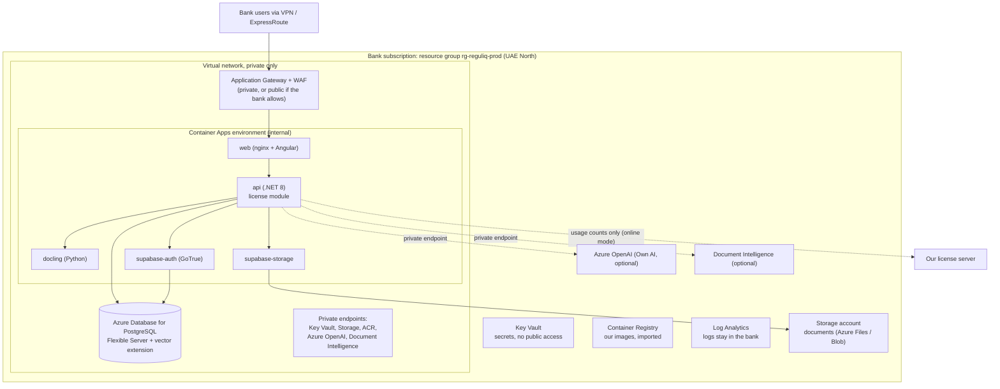

# Deploying into a bank's Azure subscription by script

Status: design only, written 20 Oct 2026. No templates or scripts from this file exist yet. Commands below show the intended shape.
Master plan: [full-plan.md](full-plan.md).

## 1. Summary

Yes, we can ship the platform as an **Azure package** that installs with one script. The package is: our container images + Bicep
infrastructure templates + one PowerShell script (`deploy-inhouse-azure.ps1`). The bank's cloud team (or our engineer with their access)
runs it against the bank's own Azure subscription. Everything lands in one resource group in the bank's tenant, in the region they choose
(UAE North for UAE banks). Re-running the script with a new version number upgrades the install.

Later, the same templates can be listed on Azure Marketplace so a bank can deploy with a click (section 9).

This is the Azure flavour of "bank private cloud tenant" in [full-plan.md](full-plan.md) section 4. Licensing, AI keys and billing are the
same as for any in-house install.

## 2. Routes on Azure

| Route | What it is | Who runs it | Our effort | When |
| --- | --- | --- | --- | --- |
| A. VM + compose (first) | Script creates a private Linux VM (or two) in the bank's VNet and runs the same Docker Compose package we use on-prem; optionally uses Azure Database for PostgreSQL instead of the DB container | Bank cloud team or us | Lowest: one package for on-prem and Azure | First Azure bank |
| B. Azure PaaS | Script deploys Azure Container Apps (web, API, Docling, Supabase auth + storage), Azure Database for PostgreSQL Flexible Server, Key Vault, private endpoints | Bank cloud team or us | Medium | Banks that want managed services, no VMs to patch |
| C. AKS + Helm | Bank's own Kubernetes cluster, our Helm chart | Bank platform team | Medium | Banks with an AKS platform |
| D. Azure Marketplace | Same templates published as a Marketplace offer, click to deploy into the bank subscription | Bank | Medium + Microsoft certification | Once two or three banks have used A or B |

Recommendation: build A first (it reuses the on-prem compose package exactly), then B when a bank asks for PaaS.

## 3. Target architecture on Azure (route B)



Route A is the same picture with one or two VMs in place of the Container Apps environment.

## 4. Azure resources the templates create

| Resource | Route A (VM) | Route B (PaaS) | Notes |
| --- | --- | --- | --- |
| Resource group with tags (`customer`, `environment`, `version`) | Yes | Yes | One per install (prod, test, DR) |
| Virtual network + subnets + network security groups | Yes | Yes | No public IPs on app or DB |
| Linux VM(s) with Docker, managed disk encryption | 1 to 2 | - | Sizes from [full-plan.md](full-plan.md) section 5 |
| Container Apps environment (internal) + apps | - | Yes | Revisions give instant rollback |
| Azure Database for PostgreSQL Flexible Server | Optional | Yes | `vector` must be allow-listed in `azure.extensions`, then `CREATE EXTENSION vector` in the database ([Microsoft docs](https://learn.microsoft.com/en-us/azure/postgresql/extensions/how-to-use-pgvector)); private access; automated backups with point-in-time restore |
| Storage account (documents) | Optional | Yes | Private endpoint; see the storage note in section 6 |
| Key Vault | Yes | Yes | All secrets; app reads them with a managed identity |
| Container Registry (bank's own) | Optional | Yes | Images imported from ours, see section 5 |
| Log Analytics workspace | Yes | Yes | Diagnostics stay in the bank tenant |
| Application Gateway with WAF | Optional | Optional | Or internal load balancer only |
| Azure OpenAI | Optional | Optional | Own AI only (`-CreateAzureOpenAI`) |
| Azure Document Intelligence | Optional | Optional | `-CreateDocIntelligence` |
| Budget alert on the resource group | Yes | Yes | Bank sees its Azure spend early |

The bank pays its own Azure consumption. Estimate it with the Azure pricing calculator during discovery for the chosen sizes.

## 5. What the package contains

```
reguliq-inhouse-azure-2026.11.0/
  deploy-inhouse-azure.ps1        one script: install, upgrade, what-if
  deploy-inhouse-azure.sh         same for bash users
  infra/
    main.bicep                    entry point
    modules/network.bicep
    modules/keyvault.bicep
    modules/postgres.bicep
    modules/storage.bicep
    modules/registry.bicep
    modules/containerapps.bicep   route B
    modules/vm.bicep              route A
    modules/ai.bicep              optional Azure OpenAI + Document Intelligence
    parameters.example.json
  compose/
    docker-compose.yml            route A, same file as on-prem
  release-manifest.json           version, image names and digests, checksums
  release-manifest.sig            our signature over the manifest
  README.md                       prerequisites, parameters, troubleshooting
```

Images: either the script imports them from our registry into the bank's own registry (`az acr import`, using a pull token tied to the
bank's license), or the bank's team imports them. Banks usually prefer their own registry behind a private endpoint. The script checks
every image digest against the signed manifest before deploying.

## 6. The script

Planned usage:

```powershell
# Preview only: shows every resource that would be created or changed (for the bank's change approval)
.\deploy-inhouse-azure.ps1 -SubscriptionId <id> -Location uaenorth -Prefix bankalpha -Environment prod -Route paas -Version 2026.11.0 -WhatIf

# Install
.\deploy-inhouse-azure.ps1 -SubscriptionId <id> -Location uaenorth -Prefix bankalpha -Environment prod -Route paas -Version 2026.11.0 `
  -AiMode own -CreateAzureOpenAI -CreateDocIntelligence -LicenseMode online

# Upgrade later: same command, new version
.\deploy-inhouse-azure.ps1 -SubscriptionId <id> -Location uaenorth -Prefix bankalpha -Environment prod -Route paas -Version 2026.12.0 -Upgrade
```

What it does, in order:

1. Check prerequisites: Azure CLI and Bicep present, signed in, right subscription, caller has Contributor and permission to assign roles on
   the resource group (needed for managed identities).
2. Verify the package: checksum and signature of `release-manifest.json`.
3. With `-WhatIf`: run `az deployment group what-if` and stop. Bank cloud teams usually need this output for approval, and it also shows
   whether the bank's Azure Policy blocks any resource.
4. Create or update the resource group with tags.
5. Deploy `main.bicep` (network, Key Vault, PostgreSQL with `vector` allowed, storage, registry, logs, compute for the chosen route,
   optional Azure OpenAI and Document Intelligence). Bicep is declarative, so re-running only changes what differs.
6. Generate secrets the first time only (database password, Supabase JWT secret and service key, app encryption key) straight into Key
   Vault. Never printed, never written to disk.
7. Import images into the bank's registry and verify digests.
8. Create the `vector` extension in the database.
9. Start the containers (new Container Apps revision, or `docker compose up` on the VM) with the in-house settings profile.
10. Wait for the API health address; the API creates and upgrades its own tables on first start.
11. Print the portal address and the **install id** (needed to issue the license), plus next steps: load license, create first admin,
    set certified models, run the acceptance checklist.

Upgrade (`-Upgrade`): take an on-demand database backup or note the point-in-time restore time, import the new images, deploy a new
revision, wait for health. Rollback on route B = switch traffic back to the previous Container Apps revision (plus point-in-time restore
if the database changed); on route A = previous compose version.

## 7. Azure-specific points to know

- **Supabase on Azure.** The API uses Supabase sign-in (GoTrue) and Supabase Storage. Both run as containers. Supabase Storage needs
  local disk or an S3-compatible store; on Container Apps that means an Azure Files volume. The cleaner long-term option is the
  "independent local providers" path in [../roadmap/ON-PREM-DEPLOYMENT-TODO.md](../roadmap/ON-PREM-DEPLOYMENT-TODO.md) (a storage provider
  for Azure Blob or local disk, and sign-in via the bank's Entra ID). Route A avoids this question by running the whole self-hosted Supabase
  stack inside the VM.
- **Tesseract on Linux.** The existing roadmap notes the Tesseract NuGet package only ships Windows native binaries. The Linux API image
  must install `tesseract-ocr` and its language data (or the OCR step silently returns empty text). Must be solved in the container build.
- **Azure OpenAI and data residency.** Check model availability in the bank's region, and pick a deployment type that keeps processing in
  the region the bank needs. Community reports say some deployments provisioned in UAE North are processed in other regions, so confirm
  with Microsoft for each bank before promising residency
  ([Microsoft Q&A](https://learn.microsoft.com/en-us/answers/questions/5585510/clarification-needed-is-gpt-oss-model-deployed-as)).
- **Region services.** Confirm every service used (Container Apps, PostgreSQL Flexible, Document Intelligence, Azure OpenAI) is offered in
  the chosen region before the bank's approval. If one is not, route A (VMs) plus local engines is the fallback.
- **Private only.** No public IPs on the app, database, Key Vault, storage or registry; users come in over the bank's VPN or ExpressRoute.
  Outbound is limited to the approved hosts (the app's `Privacy:AllowedOutboundHosts` plus the bank's firewall or NAT rules).
- **Managed identities, not passwords,** for the app to read Key Vault and pull images.
- **Bank policies.** Many banks enforce Azure Policy (allowed regions, SKUs, mandatory tags, no public endpoints). The what-if run catches
  conflicts early.

## 8. AI choice on Azure

| AI mode | What the script does |
| --- | --- |
| Own AI, Azure OpenAI | `-CreateAzureOpenAI` creates the resource and model deployments in the bank's group with a private endpoint, or points at an existing one with `-AzureOpenAIEndpoint` |
| Own AI, bank's OpenRouter | Stores the bank's key in Key Vault; adds `openrouter.ai` to the allowed hosts |
| Managed AI | Stores our per-bank OpenRouter key in Key Vault (we hand it over at install); adds `openrouter.ai` to the allowed hosts |
| Package C (bank-hosted model) | Points the OpenAI-compatible endpoint at the bank's model server; no outbound AI host |

Document reading: `-CreateDocIntelligence` creates the bank's own Document Intelligence with a private endpoint; otherwise local engines
only.

## 9. Azure Marketplace (later)

| Offer type | What it gives | Billing through Microsoft | Our access to the bank's resources |
| --- | --- | --- | --- |
| Solution template | Same Bicep/ARM templates, deployed by the bank from Marketplace with a guided form | No (we invoice as today) | None |
| Managed application | Resources land in a managed resource group | Yes: monthly or metered, but only for a management fee, not software/IP | Publisher-managed (we have access) or customer-managed (our access removed) |
| Container or VM offer | Our images sold through Marketplace | Yes, for software/IP | None |

Microsoft's rules: a managed application is the transactable version of a solution template; its monthly or metered price may only cover
the management fee, while software/IP cost must be sold through the underlying VM or container offer
([managed applications overview](https://learn.microsoft.com/azure/managed-applications/overview),
[metered billing](https://learn.microsoft.com/th-th/partner-center/marketplace-offers/azure-app-metered-billing)).

Why it can be attractive later: banks can buy through their existing Azure agreement, and Marketplace spend often counts toward their
committed Azure spend. Why not first: Microsoft certification, the billing rules above, and banks usually refuse publisher access to their
resources anyway. Start with the script (routes A and B) and our own licensing; revisit Marketplace after two or three Azure banks.

## 10. How this relates to our current Azure deploys

Today `bcp-api/scripts/deploy-api.ps1` and `bcp-web/scripts/deploy-web.ps1` zip-deploy to our own App Services (`bcp-api-dev`,
`bcp-web-dev`) and push app settings from local config. That is right for our hosted environment but not for a bank: banks need
infrastructure as code they can review, secrets generated inside their Key Vault (never from a developer's local file), private
networking, and container images. The in-house script is a separate tool; the hosted deploy scripts stay as they are.

## 11. What to build

| Item | Effort | Depends on |
| --- | --- | --- |
| Container images (API with Tesseract installed, web, Docling) | Part of item 1 in [full-plan.md](full-plan.md) | - |
| Release manifest + signature | Part of item 5 in full-plan | Images |
| Bicep modules for route A (network, VM, Key Vault, logs, optional PostgreSQL) | 3 to 4 days | Images |
| `deploy-inhouse-azure.ps1` (what-if, install, upgrade, secrets, health wait) | 3 to 4 days | Bicep |
| Route B modules (Container Apps, Supabase containers with Azure Files, private endpoints, App Gateway) | 1 to 1.5 weeks | Route A |
| Test on a clean subscription in UAE North, including what-if and an upgrade and rollback | 2 to 3 days | All above |
| Marketplace listing | 1 to 2 weeks + certification | Two or three live Azure banks |

## 12. Open decisions

- [ ] Route A only for the first Azure bank, or go straight to route B?
- [ ] Our registry and pull tokens per license, or always import into the bank's registry?
- [ ] Bicep (Azure-native, recommended) or Terraform (if a bank's cloud team requires it)?
- [ ] Do we run the script for the bank, or hand it over and support?
- [ ] Marketplace: revisit after how many Azure banks?

## Sources

- Azure Database for PostgreSQL, pgvector: https://learn.microsoft.com/en-us/azure/postgresql/extensions/how-to-use-pgvector
- Azure Managed Applications overview: https://learn.microsoft.com/azure/managed-applications/overview
- Azure Application metered billing: https://learn.microsoft.com/th-th/partner-center/marketplace-offers/azure-app-metered-billing
- Azure OpenAI UAE North processing (community answer, verify with Microsoft): https://learn.microsoft.com/en-us/answers/questions/5585510/clarification-needed-is-gpt-oss-model-deployed-as

All checked 20 Oct 2026.
