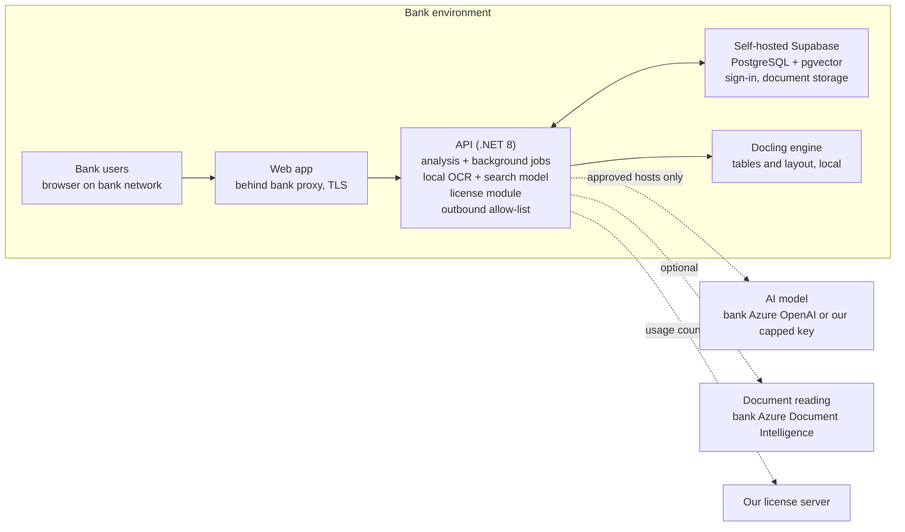
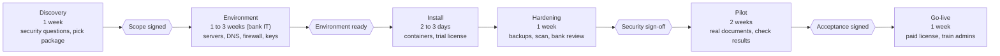

# In-house deployment: full plan

Status: plan only, written 20 Oct 2026. Nothing in this file is implemented unless the "Built today" section says so.
Start here. This is the master document; the other files in this folder go deeper on one topic each (see the index in
[README.md](README.md)).

## 1. Summary

We install the whole platform (web app, API, database, file storage, document-reading engines, search) **inside the bank's own
environment**, under a signed license we control. The bank's documents and results never sit on our servers.

Recommended standard setup for most banks:

- Runs on the bank's own servers or its private cloud tenant (for UAE banks, usually Azure UAE North).
- Document reading by our local engines, or the bank's own Azure Document Intelligence.
- AI analysis through the bank's own Azure OpenAI ("Own AI"), or our capped per-bank OpenRouter key with zero data retention
  ("Managed AI").
- Online license check-in sending usage counts only; offline license files for banks with no internet.
- Monthly subscription with a clause allowance, add-ons and packs.

Timeline: about 6 to 9 weeks from first technical call to live for a typical bank, most of it waiting on the bank's own approvals and
server provisioning. Our own install work is a few days.

Before the first bank we still need container packaging, the license module, update packages and a security evidence pack: roughly
6 to 8 weeks of engineering (section 14).

## 2. At a glance

Users, the app, the database and the document engines all sit inside the bank. The only calls that leave go through the bank's
firewall to hosts it approved. Air-gapped installs drop all dashed lines: local engines, a bank-hosted model, and license files by hand.

## 3. All deployment options

Every installation is a combination of four independent choices.

| Choice | Options | Default |
| --- | --- | --- |
| 1. Where it runs | Hosted by us (today's portal); bank data centre (servers or VMs); bank private cloud tenant (Azure, AWS, GCP); bank Kubernetes / OpenShift | Bank private cloud or data-centre VMs |
| 2. Document reading | Local engines only (PdfPig, Tesseract, RapidOCR, Docling); bank's own Azure Document Intelligence; ours (Managed) | Local engines, Azure if the bank has it |
| 3. AI analysis | Bank's own Azure OpenAI; bank's own OpenRouter; our per-bank OpenRouter key (Managed AI); models the bank hosts itself | Bank's Azure OpenAI, or Managed AI for smaller banks |
| 4. Network | Connected (outbound to approved hosts); restricted (only AI + license hosts); air-gapped (nothing leaves) | Restricted |

The combinations we offer as packages (the README's models A, B, C map onto these):

| Package | Where | Reading | AI | Network | Documents leave the bank? | For whom |
| --- | --- | --- | --- | --- | --- | --- |
| A. Hosted | Our cloud | Ours | Ours | Internet | Yes (demo and trials only) | Evaluation, small firms |
| B1. In-house, Managed AI | Bank | Local or ours | Our capped key, zero retention | Restricted | Clause text only, to the AI provider | Mid-size banks, no Azure tenant |
| B2. In-house, Own AI (standard) | Bank | Local or bank's Azure | Bank's Azure OpenAI | Restricted | Only to the bank's own Azure tenant | Most banks |
| C. Fully contained | Bank | Local only | Model hosted by the bank | Air-gapped | No | Banks with a no-external-AI rule |

Each in-house package can also carry extra installs: a test (UAT) install (recommended for every bank) and a disaster-recovery standby.

## 4. Where it can run

| Hosting option | What the bank provides | How we deliver | Good for | Watch out for |
| --- | --- | --- | --- | --- |
| Single server (pilot) | One Linux or Windows VM | Docker Compose package, all parts on one machine | Trials, small banks, first install | Not highly available |
| Two to three VMs (standard) | App VM, database VM, optional engine VM | Docker Compose per VM, or a Windows/Linux installer | Most production installs | Bank patches the OS; we document ports |
| Bank private cloud tenant (Azure, AWS, GCP) | VMs or a container service in their tenant, managed PostgreSQL if preferred | Same images; infrastructure template + deploy script (see [azure-deployment.md](azure-deployment.md)) | Banks already in the cloud; UAE region | Their cloud team must approve the template |
| Kubernetes / OpenShift | Their cluster and registry | Helm chart over the same images | Large banks with a platform team | Most effort for us; only when asked |
| Bare metal with GPU | Physical servers | Same images | Package C with self-hosted AI models | Needs serious GPU hardware |

One rule makes all of these possible: **ship container images** (API, web app, Docling engine, plus a tested self-hosted Supabase
setup). The same images run on one VM, several VMs, any cloud or Kubernetes. For banks that refuse containers, a plain installer (.NET API
as a service, web app behind IIS or nginx) is the fallback; README section 8 already describes that route.

## 5. Components and server sizing

| Component | What it does | Runs as |
| --- | --- | --- |
| Web app (`bcp-web`, Angular) | The portal users see | Static files behind the bank's reverse proxy (TLS) |
| API (`bcp-api`, .NET 8) | Upload, parse, extract, analysis, reports, background workers, license checks | Service or container |
| Database, sign-in, file storage | PostgreSQL with pgvector, user sign-in, document storage | Self-hosted Supabase |
| Document engines | PdfPig and Tesseract (inside the API), RapidOCR, Docling (`docling-service`, Python) | Inside API + one engine container |
| Search model | Passage vectors, on the server (bge-micro-v2) | Inside the API |
| License module | Checks the license, enforces limits, check-in or offline files | Inside the API (to build) |
| AI model | Judges each clause | External (Azure OpenAI / OpenRouter) or a bank-hosted model server |
| Optional queue | Dual-verify worker at high volume | Not needed; in-process fallback exists |

Starting sizes (estimates; confirm during each pilot):

| Setup | Servers | CPU / RAM / disk |
| --- | --- | --- |
| Pilot, one server | 1 VM | 8 vCPU, 32 GB RAM, 500 GB SSD |
| Standard production | App VM | 8 vCPU, 32 GB RAM, 200 GB |
| | Database VM (or managed PostgreSQL) | 4 vCPU, 16 GB RAM, 500 GB SSD, grows with documents |
| | Engine VM (Docling, OCR) | 8 vCPU, 32 GB RAM; GPU optional |
| Test (UAT) | 1 VM | 8 vCPU, 32 GB RAM, 300 GB |
| Package C, self-hosted AI | Extra GPU server(s) | Depends on the model; large open models need 48 to 80 GB GPUs |

## 6. AI and document-reading choices

Document reading:

| Option | Quality | Data leaves the bank? | Notes |
| --- | --- | --- | --- |
| Local engines | Good on clean PDFs; weaker on poor scans and complex tables | No | Default; no running cost |
| Bank's own Azure Document Intelligence | Best on scans and tables | Only to the bank's Azure, in its region | Bank pays per page |
| Our Azure Document Intelligence (Managed) | Same | To our per-bank Azure resource | Charged as credits |

AI analysis:

| Option | Quality | Data leaves the bank? | Who pays | Notes |
| --- | --- | --- | --- | --- |
| Bank's Azure OpenAI | High | Only to the bank's own Azure tenant | Bank | Standard choice (B2) |
| Bank's own OpenRouter | High, widest model choice | To OpenRouter and the provider, zero retention enforced | Bank | |
| Our per-bank OpenRouter key (Managed AI) | High | Same, under our account | Us, recharged as credits | B1; capped key per bank |
| Model hosted by the bank (C) | Lower today | No | Bank (hardware) | OpenAI-compatible route built but untested |

Sent to the AI in standard steps: each clause and the policy passages found for it, no user names or account details. The optional
qualitative assessment sends much more and is off in the in-house profile (`Privacy:DisableQualitativeAssessment`). Every bank approves a
certified model list (models we have tested).

## 7. Network modes

| | Connected | Restricted (default) | Air-gapped |
| --- | --- | --- | --- |
| Outbound allowed | Approved AI and document hosts, license server, update download | Approved AI host(s) + our license server | None |
| Inbound from internet | None | None | None |
| License | Online daily check-in | Online daily check-in | Offline license file, monthly |
| Usage report | Automatic | Automatic | Signed file exported monthly |
| Top-up packs | Automatic | Automatic | Voucher file |
| Updates | Download from our portal | Downloaded on an admin machine, copied in | Carried in by bank IT |
| AI options | All | External ones the bank approves | Package C only |

The app already refuses calls to hosts not in `Privacy:AllowedOutboundHosts`; the bank firewall rule and this list must match.

## 8. Security and compliance

| Area | Control | Status |
| --- | --- | --- |
| Data separation | Every row belongs to a workspace | Built |
| Sign-in and roles | Admin, maker, checker, reviewer | Built |
| Single sign-on | Bank IdP (Entra ID, ADFS, Okta) via SAML/OIDC | To verify with self-hosted Supabase |
| Encryption in transit | TLS everywhere | Configuration |
| Encryption at rest | Bank disk/DB encryption; app encrypts stored cloud tokens | Built + bank |
| Secrets | Bank secret store, never in files | Per install |
| Outbound control | Allow-list, HTTPS-only option | Built |
| AI provider terms | Zero retention + no training on every OpenRouter call | Built |
| Logs | No document text or prompts | Audited 15 Oct, clean |
| Audit trail | Who did what, when | Partly built |
| Retention and deletion | Workspace delete removes documents, vectors, results | To test end to end |
| Our access | None by default; temporary, bank-granted, logged | Process |
| Software integrity | Signed packages and images; SBOM | To build |
| Evidence pack | Diagrams, whitepaper, questionnaire, third-party pen test | To build |
| Legal | DPA, support-access terms, license terms, optional escrow | To prepare |

For UAE banks expect questions on data residency (all services in the UAE region), central bank outsourcing and cloud rules, and an
independent penetration test.

## 9. Licensing, subscriptions and billing (short)

- One signed license per install, sealed with our private key; the app verifies with a built-in public key. It carries paid-through
  date, limits (clauses, documents, users, workspaces), features and AI mode.
- Delivery: online daily check-in (usage counts only) or offline license files.
- We sell: free trial, monthly/annual subscription plan, recurring add-ons, one-time packs (vouchers).
- AI money: Managed AI = capped key per bank, recharged at cost x markup. Own AI = bank pays provider; we charge subscription only.
- Non-payment: grace, then read-only (data stays viewable and exportable).
- Plans are not hardcoded: templates on our side; the license carries only numbers.

Details: [licensing-overview.md](licensing-overview.md), [licensing-design.md](licensing-design.md),
[licenses-plans-updates.md](licenses-plans-updates.md), [pricing-ai-keys-profit.md](pricing-ai-keys-profit.md).

## 10. Installation runbook (all packages)

Before install day (bank IT, with our checklist):

1. Servers ready to the sizing above; OS patched; time sync on.
2. DNS name and TLS certificate for the portal address.
3. Firewall: no inbound from the internet; outbound only to the approved hosts for the chosen network mode.
4. Secret store ready; AI and Azure resources created (Own AI) or our per-bank key ready (Managed AI).

Install day (our engineer, bank IT present, 1 to 2 days):

1. Verify the release package checksum and signature.
2. Install self-hosted Supabase; replace every default password and key; create the storage bucket.
3. Start the API with the in-house settings profile (`bcp-api/appsettings.InHouse.example.json`). It creates its own tables on first
   start. Check the health address.
4. Publish the web app behind the bank's proxy with TLS; CORS = the bank's portal address only.
5. Start the Docling engine service.
6. License: note the install id, issue and load the license (trial or paid).
7. Document reading: local engines or the bank's Azure Document Intelligence (private endpoint where possible).
8. AI: approved provider and certified models; local search model on; test one sample clause.
9. First workspace and admin user; SSO if agreed.
10. Close the network: app allow-list matches the firewall; no public database port.
11. Backups on; restore test.
12. Acceptance checklist (README section 10); bank signs the acceptance report.

On Azure, steps 2 to 5 are replaced by one deploy script: see [azure-deployment.md](azure-deployment.md).

## 11. Running it after go-live

Updates: tested, signed releases every month or quarter plus urgent security fixes. Bank installs on its test install first, then
production in its change window, after a database backup. The app upgrades its own tables on start; in-house releases only add tables and
columns, so going back one version works. The license's `updatesUntil` date decides which releases a bank may install.

Backups:

| What | How often | Kept | Who |
| --- | --- | --- | --- |
| Database | Nightly full + continuous log backup | 30 days (bank policy) | Bank, our runbook |
| Document storage | Nightly | Same | Bank |
| Configuration and secrets | On every change | Vault history | Bank |
| Restore test | Quarterly, clean machine | Report kept | Bank, we support |

Disaster recovery:

| Level | How | Recovery time | Cost |
| --- | --- | --- | --- |
| Basic | Restore backups onto a new server | Hours to a day | Lowest |
| Warm standby | DR install in a second site, replicated DB, standby license | Under an hour | DR add-on |
| High availability | Two app servers + load balancer + replicated DB | Minutes | Enterprise only |

Monitoring: health address for the bank's monitoring tool. Alerts: health failing, disk over 70%, analysis jobs stuck, license within
7 days of expiry, backups failing.

## 12. Who does what

| Item | Bank | Us |
| --- | --- | --- |
| Servers, network, DNS, TLS, OS patching | Owns | Advise, sizing, port list |
| Database, storage, backups | Runs | Install, runbook, restore-test support |
| AI and Azure accounts (Own AI) | Owns and pays | Advise, configure, certify models |
| AI keys (Managed AI) | - | Per-bank key, cap, monitor, recharge |
| Application install | Present, approves | Performs |
| Updates | Applies in its change window | Build, test, sign, deliver, support |
| Licenses and billing | Uploads files (offline), pays | Issues licenses, vouchers, invoices |
| Users, roles, departments | Manages | Train admins |
| Security review, pen test of their environment | Runs | Evidence pack, fix product findings |
| Support | Opens tickets, grants temporary access | Respond per terms; no standing access |
| Analysis results and decisions | Owns (decision support only) | Not responsible for decisions |

## 13. Rollout plan for a bank

The pilot runs on a trial license; the paid license replaces it at go-live on the same install. Starting the security review during
discovery, not after install, is the biggest time saver. After go-live: monthly license renewals, releases every month or quarter,
quarterly restore tests.

## 14. Built today vs still to build

Already built: workspace separation and roles; outbound allow-list and HTTPS-only option; OpenRouter zero retention + no training;
in-house settings profile with local search model; local document engines; qualitative-assessment switch; clean logs (audited); AI credit
ledger, credit limits, clause limit; database tables that create and upgrade themselves on start.

To build before the first bank (rough, one developer):

| # | Item | Effort |
| --- | --- | --- |
| 1 | Container images (API, web, Docling) + one-server install package + tested self-hosted Supabase setup | 1.5 to 2 weeks |
| 2 | License module in the app (see [implementation-guide.md](implementation-guide.md)) | 2 weeks |
| 3 | License command-line tool + signing key in Azure Key Vault | 3 to 4 days |
| 4 | Offline extras: vouchers, signed usage export, tamper-evident usage ledger | 1 week |
| 5 | Signed release packages, version file, update and rollback runbook | 1 week |
| 6 | Workspace deletion tested end to end | 2 to 3 days |
| 7 | Security evidence pack (diagrams, whitepaper, questionnaire, SBOM) | 1 week + external pen test |
| 8 | Legal set: license terms, DPA, support-access terms | External |

Next, as banks need it:

| Item | When | Effort |
| --- | --- | --- |
| Azure deploy script and templates ([azure-deployment.md](azure-deployment.md)) | First bank on Azure | 1 to 1.5 weeks |
| Online check-in + license server | Second or third bank | 1 + 2 weeks |
| Billing automation | When manual invoicing gets heavy | 1 to 2 weeks |
| SSO with the bank's IdP | First bank that requires it | About 1 week |
| Complete audit trail | First bank that requires it | About 1 week |
| Package C: certify a bank-hosted model | First air-gapped bank | 1 week + quality testing |
| Kubernetes (Helm) packaging | First bank with that platform | About 1 week |
| Warm-standby DR / high availability | Enterprise deals | 1 to 2 weeks |

## 15. Risks

| Risk | Effect | Handling |
| --- | --- | --- |
| Bank security review takes months | Revenue delayed | Evidence pack ready before the first meeting; start review during discovery |
| Bank refuses all external AI | Only Package C, weaker results | Test a self-hosted model early; offer the bank's own in-region Azure OpenAI as middle path |
| Poor scans read badly by local engines | Wrong or missing clauses | Offer the bank's Azure Document Intelligence; pilot on real documents |
| Bank servers undersized | Slow analysis | Sizing in the checklist; measure in pilot |
| Installs drift to many versions | Support load | Support last two releases; `updatesUntil` in the license |
| License bypass or tampering | Lost revenue | Signed license, tamper-evident ledger, contract and audit clause |
| Managed AI bill unpaid | We carry AI cost | Prepaid credits, capped key, disable key at grace end |
| Signing key lost or leaked | Cannot issue, or anyone can | Key in Key Vault with backup; two public keys per release for rotation |
| Support needs access | Delays, privacy concerns | Redacted logs, screen-share, temporary access on bank terms |
| Small team, several installs | Slow rollouts | One-command install; standard runbook; one onboarding at a time |

## 16. Open decisions

- [ ] Standard package to lead with: B2, with B1 and C on request?
- [ ] Container-first packaging, plain installer only on request?
- [ ] Plans, prices, trial limits, add-on catalog, pack sizes
- [ ] In-house release cadence (monthly or quarterly); support window of two releases?
- [ ] Test (UAT) install included in Standard, or always an add-on?
- [ ] Disaster-recovery levels offered and price
- [ ] Support terms: hours, response times, on-site visits
- [ ] Penetration test vendor and budget
- [ ] Which engineering items start before a bank signs (suggested: 1 to 3)
- [ ] Azure route: script + templates only, or also an Azure Marketplace offer (see [azure-deployment.md](azure-deployment.md))
