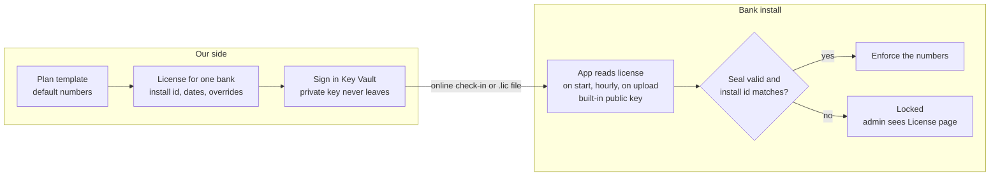

# Licensing design: signed licenses, enforcement, delivery and updates

Status: design only, written 19 to 20 Oct 2026. Nothing here is implemented yet. Business side (trials, plans, add-ons):
[licensing-overview.md](licensing-overview.md). Build steps for a developer or AI: [implementation-guide.md](implementation-guide.md).

## 1. Reality check

On-prem means the bank owns the servers, database and admin passwords. No software lock is unbreakable there. The goal is to make bypass
**hard, visible and a clear breach of contract**.

| Control | What it stops | Strength |
| --- | --- | --- |
| Signed license (private key only with us) | Creating or extending a license, adding credits by editing settings or the DB | Strong |
| Hash-chained usage ledger | Deleting usage rows to win credits back | Strong for detection |
| Online check-in | Running past an unpaid month; gives us real usage | Strong while outbound HTTPS is allowed |
| Clock rollback check | Turning the clock back to extend a license | Medium |
| Compiled, obfuscated images, no source | Patching the check out | Medium |
| Contract: license terms, audit right, penalties | All of the above, legally | Strongest in practice |

Banks are regulated and audited and rarely tamper. They also need our updates, regulation content and support, which only flow to a valid
license.

## 2. What a signature is

A digital seal only we can make and anyone can check.

- One key pair: a **private key** (makes seals; lives only in our Azure Key Vault) and a **public key** (checks seals; compiled into the
  app; safe to share).
- Signing: license text + private key -> signature (about 88 base64 characters). Checking: license text + signature + public key -> yes/no.
- Change one character (for example `"maxUsers": 25` to `250`) and the check fails; the app treats the license as invalid.
- Not encryption: the bank can read its license, it just cannot change it.
- Algorithm: **ECDSA P-256** (recommended: built into .NET and supported by Azure Key Vault signing, so the private key never leaves the
  vault). Ed25519 via BouncyCastle is an alternative but Key Vault cannot sign with it. Never invent cryptography.



## 3. License file format

A `.lic` file: readable JSON, then a signature line. Canonicalise before signing (UTF-8, keys sorted, no extra whitespace) so the same
content always produces the same bytes.

```json
{
  "licenseId": "lic_2026_11_bankalpha_01",
  "customer": { "code": "bank-alpha", "name": "Bank Alpha PJSC" },
  "installId": "inst_7c41e09a",
  "environment": "production",
  "mode": "online",
  "plan": "standard",
  "addons": ["users+10"],
  "aiMode": "managed",
  "validFrom": "2026-11-01",
  "paidThrough": "2026-11-30",
  "graceDays": 14,
  "updatesUntil": "2027-10-31",
  "nextCheckInBy": "2026-11-03",
  "limits": {
    "clausesPerPeriod": 5000,
    "documentsPerPeriod": 200,
    "maxUsers": 35,
    "maxWorkspaces": 3,
    "aiCreditsPerPeriod": 50000,
    "period": "monthly",
    "onLimit": "block"
  },
  "features": {
    "engines": ["tesseract", "rapidocr", "docling", "azure-di"],
    "dualVerify": true,
    "qualitativeAssessment": false,
    "cloudStorageImport": true
  },
  "certifiedModels": ["<provider/model ids we tested>"],
  "issuedAt": "2026-10-28T09:12:00Z",
  "keyId": "k2026"
}
signature: <base64>
```

| Field | Meaning |
| --- | --- |
| `licenseId` | Unique; renewals get a new one |
| `customer.code` | Same short code used on keys, invoices, Azure tags |
| `installId` | The one install this works on; generated by the app on first start, stored in the DB |
| `environment` | `production`, `test` or `dr` (test and DR licenses are separate add-ons) |
| `mode` | `online` (daily check-in) or `offline` (files by hand) |
| `plan`, `addons` | Display labels only; the app never decides anything from them |
| `aiMode` | `managed` (our keys, credits deducted) or `own` (bank keys, no credits) |
| `validFrom`, `paidThrough`, `graceDays` | Billing period and grace |
| `updatesUntil` | Latest release build date this license may run |
| `nextCheckInBy` | Online only: latest check-in before read-only (plus tolerance) |
| `limits` | Numbers the app enforces; a missing limit = unlimited |
| `limits.period`, `onLimit` | Counter reset period; `block` or `overage` |
| `features` | On/off switches |
| `certifiedModels` | AI models the install may use |
| `keyId` | Which signing key; allows key rotation |

Vouchers (top-up packs) use the same signing:

```json
{ "voucherId": "vch_8812", "installId": "inst_7c41e09a", "clauses": 1000, "documents": 0, "aiCredits": 0, "expires": "2027-11-15", "keyId": "k2026" }
```

The app stores every redeemed `voucherId`; a voucher works once and only on its install.

## 4. Plans are templates, not code

The app does not know what "standard" means. Plans live on our side (license server, or a JSON file for the CLI tool at first). Creating a
license copies template numbers in; any number can be overridden for one bank before signing.

| I want to... | What I do | App release needed? |
| --- | --- | --- |
| Change numbers in a plan | Edit the template; new and renewed licenses use it | No |
| Add a plan | Add a template | No |
| Custom deal for one bank | Override numbers before signing | No |
| Upgrade mid-month | Issue a new license now | No |
| Switch a feature for a bank | Change `features`, issue new license | No |
| Add a new kind of limit (for example max exports) | Build the counting and blocking in the app | Yes, once |

Rule: the app decides how to count and block; the license decides how much. Editing a template never changes licenses already issued.

## 5. License states and what the app allows

| State | When | New uploads and runs | View, search, export | Banner |
| --- | --- | --- | --- | --- |
| Active | Valid, allowance left | Allowed | Allowed | None |
| Low | Under 20% allowance left or under 7 days to paid-through | Allowed | Allowed | Admins: running low / renews on date |
| Allowance used up | Counters at limit, license in date | Blocked (or overage if `onLimit` = overage) | Allowed | Usage limit reached |
| Grace | Past paid-through, inside grace days | Allowed | Allowed | All users: payment overdue, pauses on date |
| Read-only | Grace over, or online install missed check-ins too long | Blocked | Allowed | Subscription paused |
| Locked | No license, bad signature, wrong install id, clock tampering, broken ledger chain | Blocked | Admin can open License page only | License invalid |

The app never deletes or hides data. Sign-in, the License page and exports stay open in every state.

## 6. How each limit is enforced

| Limit | Counted | Checked when | Today in the code |
| --- | --- | --- | --- |
| Clauses per period | Clauses actually analysed (re-runs not double counted; deleted runs still count) | Starting an analysis run: run must fit | Exists as lifetime `ClauseLimit` (`NdAiCreditService.GetClauseUsageAsync`); needs a period window |
| Documents per period | New uploads (regulations and internal docs) | Upload | New |
| Users | Active user accounts | Invite / create user; disabling frees a seat | New |
| Workspaces | Workspaces in the install | Create workspace | New |
| AI credits per period | Credits spent in the ledger (Managed AI) | Start run, evidence re-run | Exists (`IsExhausted` checks in `AnalysisRunsController`, `GapEvidenceRerunsController`) |
| Engines / features | On or off | Nav hidden + API refuses | Partly (engine nav groups are already hidden for demo viewers) |
| Paid-through date | Today vs license | Every request that starts new work | New |

Period reset: counters cover `validFrom` to `paidThrough`. A new period's license starts counting from zero; nothing is deleted.
Usage order with packs: allowance first, then pack balance. The app re-reads the license hourly and right after a new one arrives.

## 7. Delivery mode A: online check-in

1. Install: bank enters an activation code; the app sends it with its install id; our server returns the first license.
2. Daily check-in: app sends usage, receives the latest license and any vouchers.
3. Renewal: invoice marked paid -> next check-in returns the new period.
4. Non-payment: we stop extending `paidThrough`; grace; read-only.
5. Lost connection: keep working on the last license until `nextCheckInBy` + 7 days tolerance, then read-only until it reconnects.

Check-in payload (publish it in the bank's security pack; nothing else is sent):

| Field | Example |
| --- | --- |
| Install id, license id, app version | `inst_42c1`, `lic_8f3a`, `2026.10.19.05` |
| Usage since last check-in | 312 clauses, 4,180 credits, 9 documents, 6 runs |
| Ledger head hash | `9a1f...` |
| Active users / workspaces | 14 / 2 |
| Server time | For clock-tamper detection |

No document names, text, user names or findings. One outbound host, for example `license.<our-domain>`.

## 8. Delivery mode B: offline license file

1. Install: admin copies the install id from the License page and sends it; we return a `.lic`; admin uploads it.
2. Monthly: once paid, we email the next `.lic` a few days early; admin uploads it.
3. Packs: we email a voucher (file or pasteable string); admin redeems it.
4. Usage report: admin exports a monthly usage file signed with an install key (same fields as a check-in); we can require the last report
   before issuing the next license.
5. Non-payment: we do not send the next license.

Offline licenses should be one month long, with a slightly longer grace (21 days suggested).

| | Online | Offline |
| --- | --- | --- |
| Renewal | Automatic | Admin uploads monthly |
| Top-ups | Minutes | Email round trip |
| Usage visibility | Daily | Monthly file |
| Cut-off | Automatic | Automatic (license expires) |
| Clock-tamper risk | Low | Higher |
| Bank approval | One outbound host | None |

## 9. Tamper resistance

1. Credits only from signatures: in in-house mode the platform-admin top-up, credit-limit, clause-limit and markup endpoints in
   `AiCreditsController` are disabled; limits come from the license. (Today the platform admin can grant credits; in-house the bank's admin
   would be that platform admin.)
2. Hash-chained ledger: each `nd_ai_credit_ledger` (and usage) row stores hash(content + previous hash). Head hash goes in every check-in and
   usage report. Broken chain -> Locked + visible to us.
3. Clock rollback: store the latest time ever seen (DB + signed local file). Clock more than a day behind -> invalid until fixed.
4. Ship images, not source; obfuscate the .NET assemblies (for example Dotfuscator or Babel); never give the repo.
5. Install binding: license valid only for its `installId`.
6. Missing or invalid license = Locked, not unlimited (today a hosted workspace with no grants is unlimited; in-house must not be).

## 10. Creating licenses and guarding the key

One-time setup:

1. Generate the ECDSA P-256 key in Azure Key Vault (non-exportable). Note its `keyId`.
2. Put the public key and `keyId` in the app code.
3. Only two named people get sign permission on the vault.

Per bank:

1. Bank installs; install id shown on the License page (offline) or sent with the activation code (online).
2. Choose plan template, override numbers.
3. Run the CLI (planned, does not exist yet):

```bash
license-tool issue --customer bank-alpha --install inst_7c41e09a --plan standard --from 2026-11-01 --to 2026-11-30 --set maxUsers=40 --out bank-alpha-2026-11.lic
license-tool voucher --customer bank-alpha --install inst_7c41e09a --clauses 1000 --out bank-alpha-vch-8812.txt
```

4. The tool fills the template, applies overrides, asks Key Vault to sign, saves the file, records it in the issued-licenses list.
5. Online: served at the next check-in. Offline: emailed.

Later the same logic moves behind an admin screen on our license server with billing linked.

| Key risk | Protection |
| --- | --- |
| Stolen | Non-exportable key; signing happens inside the vault |
| Lost | Vault backup and soft delete |
| Must rotate | Each release ships two public keys (current, next); switch signing on a set date |
| Unapproved signing | Two named people; every signature logged |

## 11. Updates for in-house installs

We publish; the bank installs. Even online installs never update themselves (bank change control).

A release (for example `2026.10.19.05`) = container images or published folders for API, web and Docling + release notes (including
setting changes) + checksum and our signature.

| Step | Online install | Offline install |
| --- | --- | --- |
| Learns of a version | Check-in returns latest version + notes; License page shows "Update available" | We email IT |
| Gets it | Private download portal or container registry, credentials tied to the license | Download on an internet machine or secure transfer, carried in |
| Checks it | Verify checksum and signature | Same |
| Installs | Change window, test install first | Same |

Install steps: test (UAT) install first -> change ticket -> DB backup -> replace containers/files -> start (app upgrades its own tables via
the schema bootstrap) -> health check and smoke list -> rollback = previous version (+ restore if needed).

Our rules: fewer, bigger in-house releases (monthly or quarterly) plus security fixes; support last two releases; in-house releases only
add tables/columns; a release built after `updatesUntil` refuses to start with that license; prompts, regulation library and dictionaries
can later ship as signed content packs without a full release.

## 12. Billing on our side

The license server holds customers, installs, plans, billing periods, received usage, issued licenses and vouchers. Monthly: invoice on
the 1st; banks mostly pay by transfer, so finance marks paid (or a payment-provider webhook); paid -> next license; unpaid -> reminders at due
date, +7, +14 days, grace runs out by itself. Late payment -> mark paid -> service restored by the next license.

## 13. Implementation phases (summary)

| Phase | Build | Unlocks | Effort |
| --- | --- | --- | --- |
| 1 | In-house flag, license verify, install id, states, gates, banners, License page, platform credit endpoints off | First install, offline | 1.5 to 2 weeks |
| 2 | Vouchers, hash-chained ledger, clock check, signed usage export | Offline top-ups and verified usage | 1 week |
| 3 | License server (ours) with Key Vault signing | Stop hand-signing | 1.5 to 2 weeks |
| 4 | Online check-in | Automatic renewal and cut-off | 1 week |
| 5 | Billing automation | Hands-off monthly billing | 1 to 2 weeks |
| 6 | Packaging and security pack | Bank security review | 1 to 2 weeks, in parallel |

Phases 1 and 2 plus the CLI tool are enough for the first in-house trial. Hosted customers are unaffected: with the in-house flag off,
behaviour stays exactly as today. Detailed build notes: [implementation-guide.md](implementation-guide.md).
