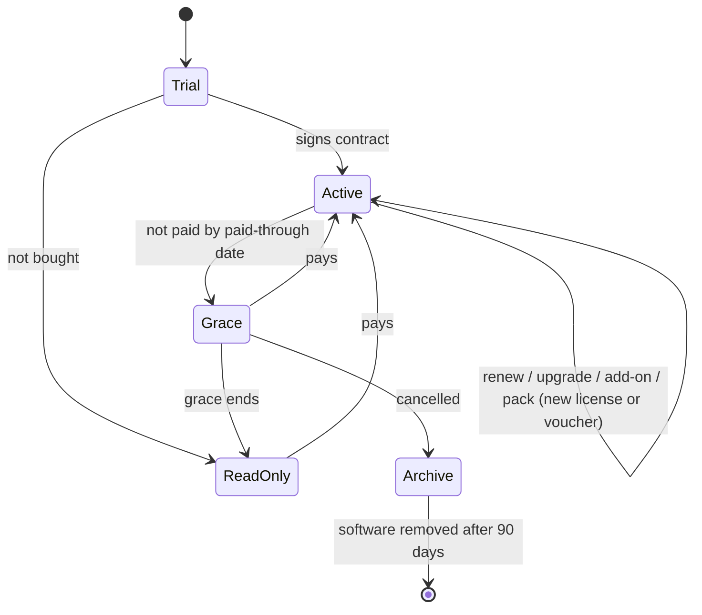

# Licensing overview: trials, subscriptions and add-ons

Status: design only, written 19 to 20 Oct 2026. Nothing here is implemented yet. All numbers and prices are examples, not decisions.
Technical design (signature, file format, enforcement): [licensing-design.md](licensing-design.md).
Money side (AI keys, costs, profit): [pricing-ai-keys-profit.md](pricing-ai-keys-profit.md).

## 1. Summary

Every in-house installation runs on **one signed license** at a time. The license holds everything the bank has bought: plan, add-ons,
the dates it is paid for, and the final numbers the app must enforce. The app never needs to know prices or plan names.

| What we sell | What it is | How long it lasts |
| --- | --- | --- |
| Trial | Free, small, time-limited license so a bank can test on its own documents | Usually 30 days, then stops or converts |
| Subscription | A plan paid monthly or yearly: users, workspaces, monthly clause allowance, features, support, updates | Renews every period while paid |
| Add-ons | Recurring add-ons (extra users, a feature, a test install) charged every period, and one-time packs (extra clauses, documents, AI credits) | Recurring: while subscribed. Packs: until used or expired |

Any change (trial converts, renewal, upgrade, add-on) means we issue a new license that replaces the old one. Online installs receive it
automatically; offline installs get a file.

## 2. Lifecycle



## 3. Building blocks

| Block | What it is | Example | Lives where |
| --- | --- | --- | --- |
| Customer | A bank with a contract | `bank-alpha` | Our side |
| Install | One running copy at that bank (production, test, DR) | `inst_7c41e09a` | Created by the app, recorded on our side |
| Plan | Template: price, period, default limits, features | Standard | Our side |
| Add-on | Recurring extra on top of the plan | +10 users | Our side |
| Pack | One-time bundle of usage | 1,000 clauses | Our side, delivered as a voucher |
| Billing period | One month (or year): invoiced, paid, overdue | Nov 2026, paid | Our side |
| License | Signed file with the final numbers for one install and one period | `lic_2026_11_bankalpha_01` | Sent to the install |

Rule: prices, plan names and add-on catalogs stay on our side. The license carries only final numbers, switches and dates, so plans and
prices change without a software release.

## 4. Trials

| Setting | Suggested | Why |
| --- | --- | --- |
| Length | 30 days | One compliance review cycle |
| Clauses | 500 total | About 10 to 15 policies analysed |
| Documents | 20 total | Not usable as free production |
| Users / workspaces | 5 / 1 | Small evaluation team |
| Features | Everything in Standard | Show the real product |
| AI | Managed AI with a small capped key, or the bank's own keys | Our key cap limits our cost |
| Grace | 3 days | It was free |
| Price | Free, or setup fee credited against year one | Covers install time |

Flow: sales records the trial; bank installs; we issue a trial license for the install id; License page shows days and usage left; one
extension allowed (new trial license); on signing we issue a paid license for the **same install id** (no reinstall, trial work kept);
unsold trials run out to read-only, the bank exports, then removes the software.

A trial is not a demo account. Demo accounts (hosted portal) replay fixed seeded results and never analyse real documents (see the
repo CLAUDE.md). A trial is the real pipeline.

## 5. Subscriptions

Example plans:

| | Starter | Standard | Enterprise |
| --- | --- | --- | --- |
| Users | 10 | 25 | 100 |
| Workspaces | 1 | 3 | 10 |
| Clauses per month | 1,500 | 5,000 | 20,000 |
| Documents per month | 60 | 200 | Unlimited |
| Document engines | Local | All incl. Azure | All incl. Azure |
| Dual verification | No | Yes | Yes |
| Qualitative assessment | No | No | Yes |
| Support | Email, business hours | Email + calls | Named contact |
| Test (UAT) install | Add-on | Included | Included |

- Monthly: one invoice and one license per month. Annual: 12-month commitment, still licensed month by month so allowances reset and
  non-payment bites within weeks.
- Renewal: next license issued when the invoice is marked paid; counters reset. Suggested: unused monthly clauses do not roll over; packs do.
- Upgrade mid-period: new license immediately for the rest of the period; invoice the difference pro-rata; usage already counted stays.
- Downgrade: at next renewal only; the bank must fit the smaller limits (for example disable extra users) or new users are blocked.
- Cancel: last paid license runs to end + grace, then an archive license (read-only, 90 days) for export and audit, then removal.

## 6. Add-ons

Recurring add-ons (charged every period, on every license while subscribed):

| Add-on | Effect in the license | Billed |
| --- | --- | --- |
| Extra users (per 5 or 10) | `maxUsers` + n | Monthly |
| Extra workspace | `maxWorkspaces` + 1 | Monthly |
| Bigger monthly allowance | `clausesPerPeriod` + n | Monthly |
| Azure document reading engine | `features.engines` includes `azure-di` | Monthly |
| Dual verification | `features.dualVerify` = true | Monthly |
| Test (UAT) install | Second, non-production license for the test install id | Monthly |
| Disaster recovery install | Standby license for the DR install id | Monthly, lower price |
| Premium support | Contract only, not in the license | Monthly |

One-time packs (paid once, delivered as a signed voucher redeemed once):

| Pack | Effect | Expires |
| --- | --- | --- |
| Clause pack | + n to a pack balance | 12 months or never (to decide) |
| Document pack | + n to a pack balance | Same |
| AI credit pack (Managed AI) | + credits in the AI ledger | Same |

Usage order: monthly allowance first, then pack balance. Unused pack balance carries over; unused allowance does not.
If a bank's add-ons cost more than the next plan, sales suggests the upgrade.

## 7. How it lands in one license (example)

Bank Alpha: Standard + 10 users + 1 workspace + one 1,000-clause pack.

| Limit | Plan | Add-ons | In the license |
| --- | --- | --- | --- |
| Users | 25 | +10 | 35 |
| Workspaces | 3 | +1 | 4 |
| Clauses per month | 5,000 | - | 5,000 |
| Clause pack balance | - | +1,000 voucher | 1,000 (separate, carried over) |

```json
{
  "licenseId": "lic_2026_11_bankalpha_02",
  "customer": { "code": "bank-alpha" },
  "installId": "inst_7c41e09a",
  "plan": "standard",
  "addons": ["users+10", "workspace+1"],
  "validFrom": "2026-11-01",
  "paidThrough": "2026-11-30",
  "limits": { "maxUsers": 35, "maxWorkspaces": 4, "clausesPerPeriod": 5000, "documentsPerPeriod": 200 },
  "features": { "engines": ["tesseract", "rapidocr", "docling", "azure-di"], "dualVerify": true }
}
```

Voucher for the pack (separate file, own signature):

```json
{ "voucherId": "vch_8812", "installId": "inst_7c41e09a", "clauses": 1000, "expires": "2027-11-15" }
```

`plan` and `addons` are labels for the License page and support. The app enforces only `limits` and `features`.

## 8. Every lifecycle event

| Event | What we do | What the app gets | What users see |
| --- | --- | --- | --- |
| Trial starts | Record customer; issue trial license | Trial license | Trial banner, days left |
| Trial extended | New trial license | New license | New end date |
| Trial converts | Contract; first paid license, same install | Paid license | Banner gone, work kept |
| Trial ends unsold | Nothing | License runs out | Read-only, then removal |
| Period renews | Mark paid; next license | Next license, counters reset | Nothing |
| Upgrade mid-period | New license; pro-rata invoice | New license now | Higher limits in minutes |
| Downgrade | Set for next renewal | Smaller license at renewal | Warning if over limits |
| Recurring add-on added | New license; pro-rata invoice | New license now | Higher limit / new feature |
| Recurring add-on removed | Drop at next renewal | Smaller license at renewal | Change at period end |
| Pack bought | Invoice; voucher | Voucher | Pack balance shown |
| Invoice overdue | Reminders; no new packs | Nothing | Admins: payment overdue |
| Paid-through passes | Automatic | Grace starts | All users: service pauses on date |
| Grace ends | Disable AI keys (Managed AI) | Read-only | Subscription paused; data viewable |
| Late payment | Mark paid; issue license | New license | Full service back |
| Cancellation | Stop renewals; 90-day archive license | Archive license | View and export only |
| New install (test, DR, server move) | License for new install id; revoke old if moving | License | Nothing |

## 9. Monthly invoice

One invoice per bank per month, issued on the 1st:

| Line | Type |
| --- | --- |
| Plan | Recurring, in advance |
| Recurring add-ons | Recurring, in advance |
| Add-on added mid-month | One-time, pro-rata |
| Packs | Prepaid before the voucher is issued |
| Overage clauses (only if the contract uses overage instead of blocking) | Usage, in arrears |
| AI credits used (Managed AI) | Usage, in arrears, cost x markup |

In-advance lines unpaid means no next license. In-arrears lines come from reported usage (check-ins or monthly usage file). Every line
carries the customer code and period, matching the license.

## 10. Who does what

| Who | Responsible for |
| --- | --- |
| Us: sales | Trials, plans, add-ons, prices; records them on the license server |
| Us: finance | Invoices, marking payments, chasing overdue |
| Us: license server (CLI tool at first) | Plans, catalog, customers, installs; computes final numbers; signs licenses and vouchers; delivers; disables AI keys at grace end |
| Bank admin | Uploads license files and vouchers (offline); exports usage file (offline); manages users within the seat count |
| Bank IT | Installs software and updates; keeps the clock correct; allows the one outbound host (online) |
| The app | Checks the seal; enforces limits and features; counts usage; banners and License page; read-only when told |

Nothing about money happens inside the bank's install.

## 11. Open decisions

- [ ] Plans to launch with (Starter / Standard / Enterprise or fewer)
- [ ] Numbers and prices per plan
- [ ] Trial limits; setup fee for trials?
- [ ] Unused monthly allowance: lost (suggested) or carried over?
- [ ] Do packs expire?
- [ ] At the limit: block, or overage billed next month?
- [ ] Add-on catalog and prices
- [ ] Archive period after cancellation (suggested 90 days)
