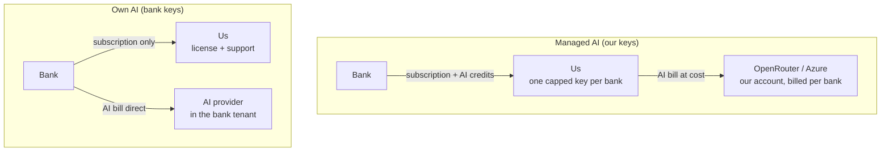

# In-house pricing: AI keys, costs and profit

Status: design only, written 19 Oct 2026. Example numbers are illustrative, not prices. Existing AI credit mechanics (ledger, markup,
credit size) are documented in [../costing/AI-CREDITS-COSTING.md](../costing/AI-CREDITS-COSTING.md).

## 1. Summary

Every in-house bank pays a **software subscription**, whoever's AI keys it uses. AI is a separate line, handled one of two ways:

- **Managed AI (our keys):** we supply the AI and document-reading services and resell usage as credits at cost x markup. Each bank gets
  **its own OpenRouter key and its own Azure resource group**, with a spending cap, so its cost is tracked separately and can be switched
  off on its own.
- **Own AI (bank's keys):** the bank opens its own Azure OpenAI / OpenRouter / Azure Document Intelligence and pays the provider directly.
  We charge the subscription only, priced a bit higher because we earn nothing on AI.

Profit comes from the subscription (main margin; the bank pays for its own servers), the AI markup (Managed AI only) and setup fees.

## 2. The two setups compared

| | Managed AI | Own AI |
| --- | --- | --- |
| Who opens OpenRouter / Azure accounts | Us | Bank |
| Keys | One OpenRouter key + one Azure resource group per bank, created by us | Bank's own, entered by its admin |
| Who pays the provider | Us, recharged to the bank | Bank |
| Where document text goes | AI provider through our account (zero retention, no training) | Bank's own Azure tenant/account, its region |
| What we invoice | Subscription + AI credits (cost x markup) | Subscription only |
| Our AI margin | Yes | None |
| Our risk | We pay AI even if the bank pays late | None on AI |
| Cost tracking | Per bank, from its key and resource group | Bank sees its own bill |
| Stop on non-payment | License expires + disable keys at once | License expires |
| Bank effort | Lowest | Must manage AI accounts and models |
| Typical bank | Smaller banks, pilots, no Azure tenant | Large banks with "our keys, our region" rule |

A bank can start a pilot on Managed AI and move to Own AI later; it is a settings change, not a reinstall.

## 3. What every bank pays (both setups)

| Charge | When | Covers |
| --- | --- | --- |
| Setup fee | Once | Installation, configuration, security review support, training |
| Platform subscription | Monthly or annual billed monthly | License, regulation content, updates, support, users and workspaces |
| Usage allowance | Included | Monthly clauses analysed (and/or documents) |
| Overage | Monthly in arrears | Clauses above allowance, or block at limit |
| AI credits | Managed AI only | AI and document-reading usage at cost x markup |
| Extra users / workspaces | Monthly | Seats above plan |

Count the allowance in **clauses analysed**: it means the same in both setups. The clause limit already exists in the product.

## 4. Managed AI: per-bank keys

Never share one key across banks: costs cannot be separated and one bank cannot be cut off alone.

OpenRouter, one key per bank. OpenRouter's management API creates keys programmatically, each with its own credit `limit`, a
daily/weekly/monthly `limit_reset`, a `disabled` switch, and per-key usage readouts; its docs name "a unique key per customer instance"
as a use case (https://openrouter.ai/docs/features/provisioning-api-keys, checked 19 Oct 2026). Per bank:

1. Create key `bank-alpha-prod`.
2. Limit slightly above the prepaid/committed monthly amount, monthly reset (caps our loss).
3. Put it in the install's secret store at setup.
4. Non-payment: disable the key; AI stops at once.

Azure, one resource group per bank, tagged with the customer code, in the bank's chosen region (UAE North for UAE banks): Document
Intelligence and, if used, Azure OpenAI. Azure bills per resource, so Cost Management shows each bank separately; add a budget alert on the
group. Each resource has its own keys to rotate or revoke.

Charging: the app's ledger (`nd_ai_credit_ledger`) already stores our real cost, credits and billed USD per call. For in-house banks:
prepaid credit packs (safest) or monthly included credits + overage; markup 1.3x to 1.5x (23% to 33% margin); monthly reconciliation of the
ledger against the OpenRouter key usage and the Azure group cost (should match within a few percent).

Risk: the key sits on the bank's server, so its IT could reuse it outside our software. The key limit caps the damage and the
ledger/OpenRouter mismatch shows it. If ever needed: a small gateway on our side that holds the real keys and forwards calls.

## 5. Own AI: bank's keys

Bank sets up (we give a checklist): Azure OpenAI in its own tenant/region with our supported models deployed (or its own OpenRouter);
optional Azure Document Intelligence; keys in the secret store; endpoints on the app's allowed-host list.

- Certified models only: quality depends on the model; contract and license restrict to tested models (`certifiedModels`).
- We still meter clauses for the allowance. The app still records tokens and estimated cost per call but deducts no credits; the bank's
  admin can use it to understand its own provider bill.
- No AI margin, so price the Own AI subscription (or setup fee) higher to keep the same profit per bank.

## 6. Telling costs apart per bank

| Cost | Hosted customer | In-house Managed AI | In-house Own AI |
| --- | --- | --- | --- |
| Servers, DB, storage | We pay (shared Azure) | Bank | Bank |
| AI (OpenRouter) | We pay, shared platform key, split by workspace in ledger | We pay, bank's own key | Bank |
| Document reading (Azure) | We pay, shared resource | We pay, bank's own resource group | Bank, or local engines |
| Support and upgrades | Low | Higher | Higher, plus model questions |
| Where we read it | Ledger per workspace | Key usage + resource-group cost + ledger | Not our cost |

Rules: name everything after the bank code (key, resource group, tags, invoice, license customer); hosted and in-house never share keys.

## 7. Profit

| Revenue line | Our cost against it | Margin |
| --- | --- | --- |
| Setup fee | Installation days | High if priced by days |
| Subscription | Support, upgrades, content upkeep | Highest; main profit |
| AI credits (Managed AI) | Provider bill for that bank | Markup, for example 1.4x = 29% |
| Overage | Same as above | Same |

Worked example (illustrative only):

| Per month | Bank Alpha, Managed AI | Bank Beta, Own AI |
| --- | --- | --- |
| Subscription | $4,000 | $4,500 |
| AI billed (our cost $600 x 1.4) | $840 | - |
| Revenue | $4,840 | $4,500 |
| AI provider bill we pay | $600 | - |
| Support and upgrades (our time) | $800 | $1,000 |
| Profit | $3,440 (71%) | $3,500 (78%) |

The markup is $240 of $3,440, so even at 1.0x the deal stays profitable. Price the subscription on value to the bank, never let AI run
at a loss (prepaid, capped key, markup at least 1.2x), and put a clause allowance in every plan.

## 8. Non-payment by setup

| Step | Managed AI | Own AI |
| --- | --- | --- |
| Invoice overdue | Reminders; no new credit packs | Reminders |
| Prepaid credits run out | New analysis stops (no new spend) | n/a |
| Paid-through passes | Grace | Grace |
| Grace ends | Read-only + disable OpenRouter and Azure keys | Read-only |
| Bank pays | New license; re-enable keys | New license |

## 9. What to build for this

| Item | Where | Size |
| --- | --- | --- |
| `aiMode` in the license (`managed` / `own`) | App | Small |
| Own mode: record tokens and cost, deduct no credits, hide top-up banners | App | Small |
| Own mode: only certified models | App | Small |
| Create / limit / disable per-bank OpenRouter keys from our license server | License server | Small |
| Per-bank Azure resource group template (DI, optional OpenAI, tags, budget alert) | Script | Small |
| Monthly reconciliation report | License server | Medium |
| Invoice lines: subscription, overage, AI credits | Billing | Medium |
| Optional AI gateway holding real keys | Our cloud | Medium, only if needed |

## 10. Open decisions

- [ ] Subscription price per plan; Own AI uplift
- [ ] Setup fee: fixed or by days
- [ ] Clause allowance per plan; overage price or block
- [ ] Managed AI markup and credit pack sizes
- [ ] Managed AI: prepaid only, or included credits + overage
- [ ] Certified model list
- [ ] Default Azure region for Managed AI banks
